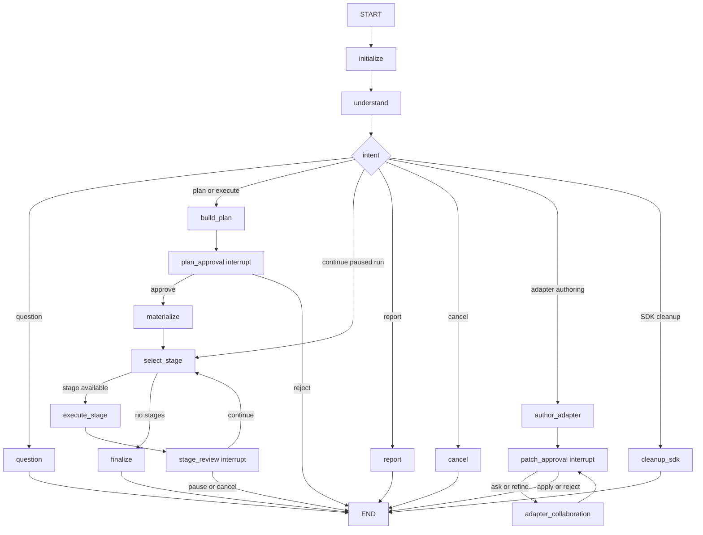
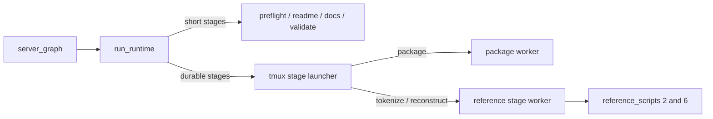
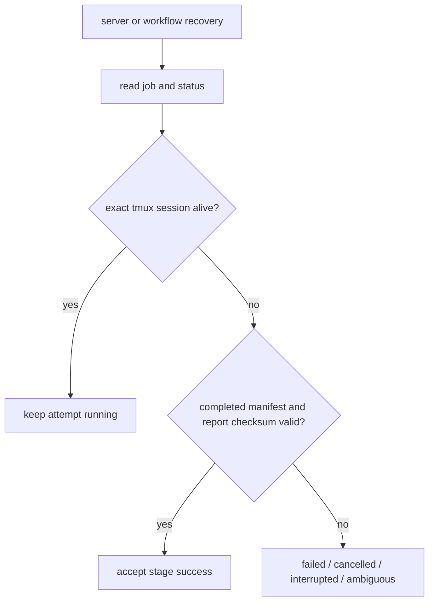

# NeuroToken Agent Server 架构

本文档以 `server_graph.py` 为唯一正式编排入口。项目不再维护独立 CLI graph。

## 1. 会话控制流



## 2. 数据阶段

阶段保持固定顺序：

```text
preflight -> package -> tokenize -> readme -> docs -> validate -> reconstruct
```

用户可以选择部分阶段；规划层会补齐必要前置阶段，`pending_stages` 驱动 `select_stage -> execute_stage -> stage_review` 循环。

## 3. 执行边界



- `preflight`、`readme`、`docs`、`validate` 是 Agent 管理的短操作。
- `package`、`tokenize`、`reconstruct` 是独立 tmux session 中的 durable stage job。
- Worker 的参数解析是 Agent Server 与科学环境之间的内部调用协议，不是用户 CLI，也不新增或暗示 HTTP API。
- `NEUROTOKEN_PIPELINE_PYTHON` 允许 worker 使用独立科学计算环境。
- `NEUROTOKEN_TMUX_SOCKET` 指定 durable stage 专用 tmux socket；启动、取消和 reconcile 必须使用同一路径，不能依赖调用者当前的 Desktop 或 SSH 会话。

## 4. Durable Run

计划批准后，`materialize_run()` 创建 run 根目录；每次执行 durable stage 都分配新的 `<stage-execution-id>`：

```text
<output-root>/runs/<workflow-id>/<run-id>/
├── run_manifest.json
├── configs/pipeline_config.toml
├── manifests/<stage>.json
├── locks/<stage>.lock
├── attempts/
│   └── <stage>/<stage-execution-id>/
│       ├── job.json
│       ├── status.json
│       ├── stdout.log
│       └── stderr.log
└── <source-slug>/
    ├── tar/
    ├── neurotoken/
    └── reports/
```

`package`、`tokenize`、`reconstruct` 的一次 attempt 遵循：

```text
lock
-> create immutable attempt/job.json
-> write attempt/status.json
-> launch tmux session with stdout/stderr logs
-> reconcile process state and artifacts
-> write report
-> checksum report
-> write completed stage manifest
```

### 4.1 Reconcile 与成功判定

Agent Server 启动或恢复 workflow 时会执行 reconcile，因此 Agent Server、Desktop 或 SSH 重启不会直接终止 durable stage。reconcile 联合检查 attempt 的 `job.json`/`status.json`、`NEUROTOKEN_TMUX_SOCKET` 上的精确 session，以及 manifest/report 产物。



tmux session 只负责承载进程并提供存活性线索，不是完成状态的权威。session 存在不能证明输出有效，session 消失也不能单独判定失败。只有 completed stage manifest 与 report 同时存在，且 report checksum 与 manifest 记录一致，阶段才可视为成功并复用。

### 4.2 Cancel 与 Retry

- cancel 必须锁定 stage，并只向 manifest/status 所指向的精确活动 attempt 和 tmux session 发出终止；同时持久化取消请求和最终状态。
- cancel 与自然完成发生竞争时，先 reconcile 产物；不得把 checksum 有效的 completed manifest/report 覆盖成 cancelled，也不得把仅因 session 消失的 attempt 标成 completed。
- retry 前必须 reconcile，并确认旧 attempt 没有仍在运行的 worker；状态不明确时拒绝启动第二个并发 worker。
- retry 始终创建新的 execution ID、attempt 目录和 tmux session。旧 attempt 的 `job.json`、`status.json`、`stdout.log`、`stderr.log` 保留用于审计，不原地清空或复用。
- failed、cancelled、interrupted 或 ambiguous attempt 不会自动成功，也不会自动执行破坏性 retry；retry 必须由明确的恢复/用户动作触发。

## 5. 前后端契约

```text
AgentState
-> workspace_projection
-> WorkspaceSnapshot 1.0
-> frontend workspace normalizer
-> Inspector and approval UI
```

审批通过 LangGraph `interrupt/resume` 完成，包括：

- `plan_approval`
- `stage_review`
- `adapter_patch_approval`

## 6. Adapter Authoring

```text
inspect HDF5
-> isolated Git worktree
-> Cursor SDK generates adapter patch
-> allowed-path validation
-> human review
-> apply and import validation
-> patch record or rollback
```

Coding Agent 只允许修改 `agent_pipeline/adapters/`。SDK cleanup 核心位于 `adapter_authoring/cleanup.py`，并按 owner/thread 校验补丁归属。
